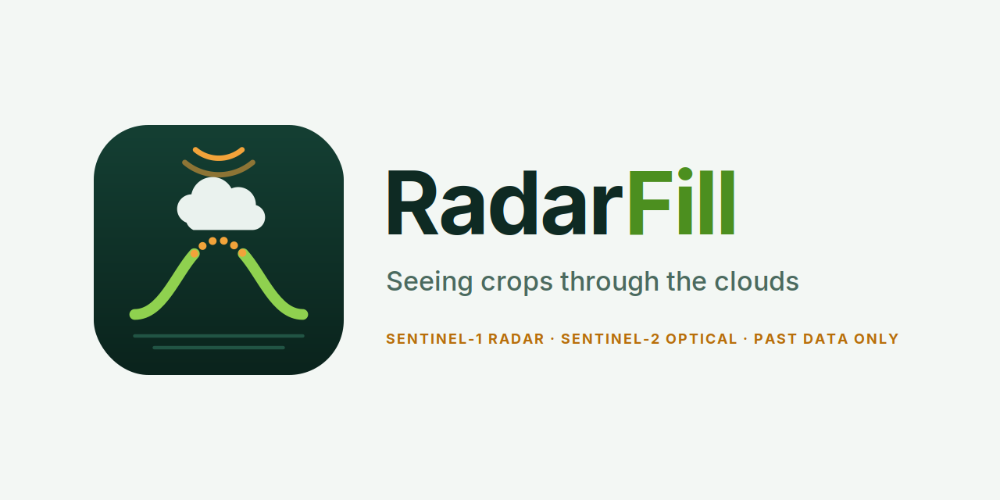

<p align="center">
  <picture>
    <source media="(prefers-color-scheme: dark)" srcset="branding/banner.png">
    
  </picture>
</p>

# RadarFill

**Early-season crop recognition from satellite time series under cloud cover.**

Clouds punch holes in each field's optical (Sentinel-2) greenness curve. RadarFill fills those gaps with radar (Sentinel-1), which sees through clouds, using **past data only**. It then names crops weeks earlier and checks that the model's confidence is honest.

Final-year research project, BSc (Hons) IT, Faculty of Information Technology, University of Moratuwa (Nov 2026 – Jun 2027).

## Project structure

| Layer | When | What |
|---|---|---|
| **0: Data Kit** | Nov | Shared field curves, folds, cut-off function, leak test |
| **1: Research tracks** | Dec – mid-Apr | Three independent tracks, one paper each |
| **2: RadarFill app** | mid-Apr – May | FastAPI + React/MapLibre; each member builds one module |

The three research tracks:
- **Track A: gap filling.** Past-only, radar-guided filling of cloud gaps, with calibrated uncertainty (± bands).
- **Track B: early recognition.** Fill vs fuse, an observation-aware classifier, and the earliest reliable date.
- **Track C: gap-aware trust.** Gap-conditional calibration and gap-stratified (Mondrian) conformal prediction sets.

## Repository layout

```
code/data_kit/   shared Layer-0 code (loading, checks, curves, folds, leak test)
code/member_a/   Track A        code/member_b/   Track B        code/member_c/   Track C
code/app/        Layer-2 application
docs/            data card, data decisions log, papers
notebooks/       exploration
outputs/         generated tables and figures (not committed)
dataset/         raw data (not committed; see below)
```

## Getting started

```bash
# 1. Python environment (uv: https://docs.astral.sh/uv/)
uv venv --seed .venv
uv pip install -r requirements.txt

# 2. Data: download PASTIS-R from its official release and extract it to dataset/PASTIS-R/

# 3. Sanity checks
.venv/bin/python code/data_kit/pastis_starter.py --n 5
.venv/bin/python code/data_kit/scan_validity.py
```

## Data

We use **PASTIS-R**: 2,433 patches over France, Sept 2018 – Oct 2019, with Sentinel-2 plus Sentinel-1 ascending and descending, and 18 crop classes. The raw data is **not** in this repository. See [docs/data_card.md](docs/data_card.md) for what we verified, and [docs/data_decisions.md](docs/data_decisions.md) for every data choice we made.

## Research rules

1. **No peeking at the future.** At cut-off date *t*, only observations dated ≤ *t* are used.
2. **Folds:** train 1–3, validate 4, test 5 (rotated ×5). The test fold is touched once.
3. **The leak test must pass.** Scrambling data after *t* must not change any output at *t*.
4. **Every data decision is logged** in `docs/data_decisions.md`.

## Contributing

See [CONTRIBUTING.md](CONTRIBUTING.md).

## Citation

See [CITATION.cff](CITATION.cff). Please also cite the PASTIS-R dataset authors.

## Licence

Code: [MIT](LICENSE). The PASTIS-R dataset is under its own licence.
